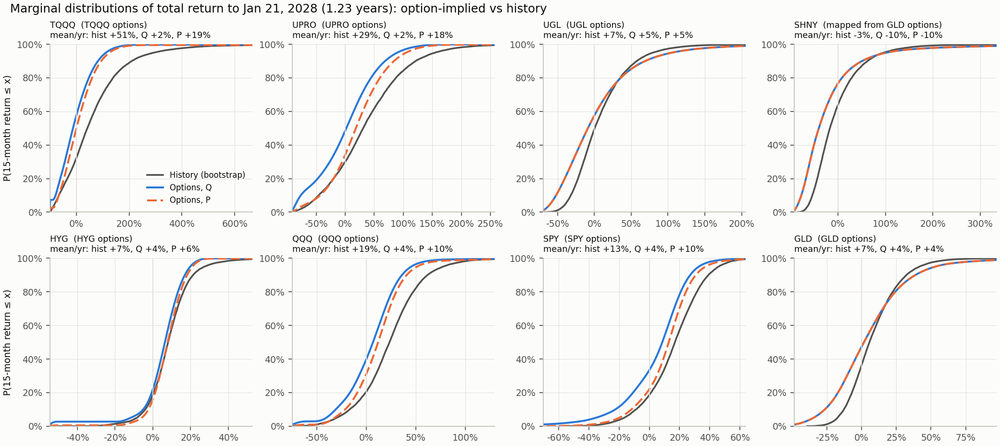
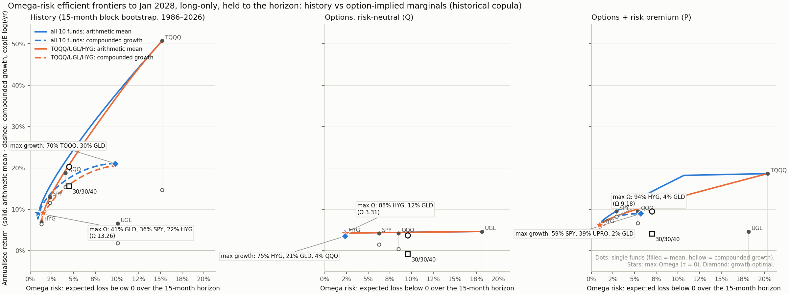
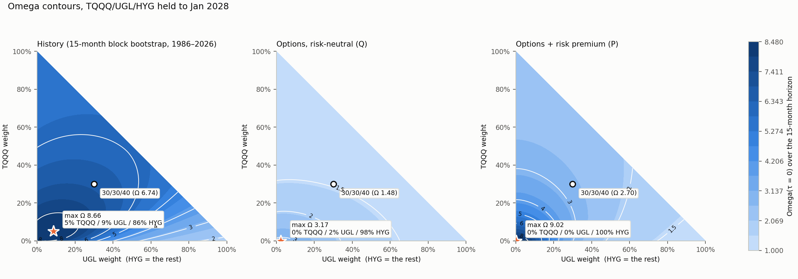
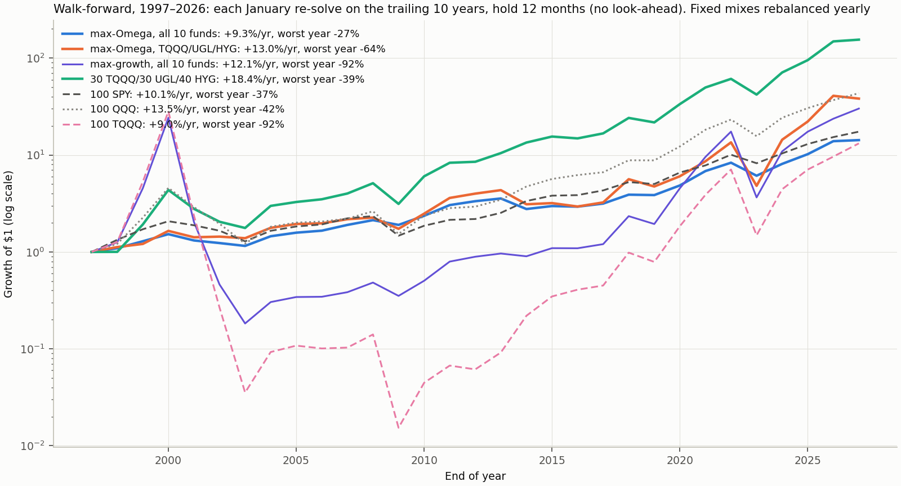

# Follow-up: option-implied marginals, compounded growth, walk-forward

There were three questions about the first study:
1. Is fitting on 1986–2005 suspicious, given how fast markets change?
2. Is the mean 1-year return the right y-axis for leveraged ETFs? Is it what you actually realise?
3. Can the marginals come from the liquid option chains instead of history, using PricedIn's algorithm?

Code: `omega/pricedin_marginals.py`, `omega/implied_study.py`, `omega/implied_plots.py`. Numbers: `results/implied_summary.json`.

## 1. Marginals from option chains (PricedIn formulation)

**Data.** CBOE delayed quotes, 2026-10-28 02:37 UTC, for the Jan 21 2028 expiry (T = 1.23 years). This is the one
long-dated expiry every fund lists. The snapshot is in `data/chains/` and includes TQQQ, QLD, UPRO, SSO, UGL, QQQ,
SPY, GLD and HYG. SHNY has no listed options.

**Algorithm.** PricedIn's `get_distr` (pricedin-algo-layer) treats the PMF p on the strike grid as the unknown
(p ≥ 0, Σp = 1). It integrates p twice into model call and put curves and least-squares fits them to the market
curves. Both curves are linear in p, so this is a **convex QP**. I solve the identical objective exactly with Clarabel
(`fit_qp`) and compare against PricedIn's own SLSQP code on the same inputs. That code is imported from a local
checkout via `PRICEDIN_ALGO_PATH` and is not copied into this repo.

| Chain | Strikes | QP (Clarabel) | SLSQP (as in algo layer) | Objective QP / SLSQP | As-is grid: mass piled at 0 / at top strike |
|---|---|---|---|---|---|
| SPY | 255 | 0.99 s | 32.0 s | 0.1853 / 0.1853 | 0% / 0% |
| QQQ | 174 | 0.33 s | 14.7 s | 0.0836 / 0.0836 | 0.7% / 2.5% |
| GLD | 168 | 0.32 s | 12.7 s | 0.2407 / 0.2407 | 0% / 0% |
| TQQQ | 83 | 0.04 s | 2.5 s | 0.0173 / 0.0173 | **10% / 26%** |
| UPRO | 63 | 0.03 s | 2.1 s | 0.0050 / 0.0050 | **7% / 25%** |
| QLD | 67 | 0.03 s | 2.0 s | 0.0060 / 0.0060 | 5% / 18% |
| SSO | 54 | 0.11 s | 2.9 s | 0.0032 / 0.0032 | 5% / 19% |
| UGL | 52 | 0.02 s | 2.1 s | 0.0576 / 0.0577 | 5% / 3% |
| HYG | 39 | 0.015 s | 2.1 s | 0.0074 / 0.0074 | 4% / 0% |

**Inputs.** Prices are put on a forward basis: mids ÷ e^(−rT), with r = 4.08% (3-month T-bill). The anchor is the
put-call-parity forward.

**Solver.** On these inputs SLSQP reaches the same optimum. The QP is **30–140× faster**, and it is exact by
construction, so `maxiter` can never stop it early.

**Problem with the as-is grid: it truncates the tails.** The grid is the listed strikes plus 0 and last + 1, so all
probability beyond the listed range piles onto those two points. The leveraged chains only go out to about 1.5–1.75×
spot, so a quarter of TQQQ's and UPRO's distribution lands on one point at the top strike. The fitted mean is also
3–7% below the forward.

### Extended fit (`fit_extended`), used for the study
It keeps the same unknown (a PMF), the same linear pricing and the same QP solver, with four changes:
1. **Grid past the listed strikes.** A log-spaced grid of 400 points runs well beyond the strike range (TQQQ:
   0.003×–35× spot).
2. **Martingale constraint, Σ p·x = F.** It is linear, so the problem stays a QP.
3. **Out-of-the-money quotes only, with errors in units of the half bid-ask spread.** Listed ETF options are American,
   and in-the-money ones carry an early-exercise premium.
4. **A small curvature penalty on p.** Mass beyond the last strike spreads out instead of spiking.

**Fit quality.** RMSE is 0.1–0.55 half-spreads, and **96–100% of quotes are priced inside their bid-ask** (SPY 96%,
all others 100%). Each fit takes 0.05–0.6 s.

**Robustness.** Fitting the whole [bid, ask] band instead of mids barely moves the tails. Every fund's own omega
risk changes by at most 0.004, except UGL (0.18 → 0.20).

**Total return.** Price ratio × e^(dT), where d is the parity carry. For leveraged funds, d is the parity carry minus
the fund's financing + fee drag: their high implied "borrow" prices the fund's own decay, which a holder never
receives.

**SHNY** is mapped from GLD's implied distribution with the daily-reset identity
ln Y = 3 ln X − 2(r + 7%)T − fee·T − 3σ²T, using GLD's implied variance.
- Check on funds that have their own chain: the mapping matches UGL and QLD well (median 0.87 vs 0.92, 0.96 vs 1.00).
- It is too pessimistic for UPRO (0.88 vs 1.03). The constant-variance identity over-charges volatility decay when the
  variance comes mostly from the crash tail.
- So direct chains are used wherever they exist.

### Q and P
Option prices give the **risk-neutral** distribution Q, under which every fund's expected total return is the T-bill
rate (minus the leveraged funds' decay). To get a real-world P, each marginal gets an **Esscher tilt**
p_P ∝ p_Q·x^γ (a power-utility pricing kernel). γ is set so the expected return rises by a chosen premium:

| Asset | Premium per year |
|---|---|
| Equity | 5% |
| High yield | 2% |
| Gold | 0 |
| L-times funds | L × their underlying's premium |

**These premia are assumptions, not estimates.** The tilt keeps the market's shape (skew, tails) and moves only the
location.

### What the options say (15-month total return; mean per year)

| Fund | History: mean | Q: mean | P: mean | P: 5th pct | History: 5th pct | P: median | History: median |
|---|---|---|---|---|---|---|---|
| TQQQ | +51% | +2% | +19% | **−77%** | −82% | +2% | +42% |
| UPRO | +29% | +2% | +18% | −66% | −61% | +19% | +31% |
| UGL | +7% | +5% | +5% | −59% | −39% | −8% | 0% |
| SHNY (mapped) | −3% | −10% | −10% | −84% | −61% | −40% | −17% |
| HYG | +7% | +4% | +6% | −6% | −8% | +8% | +8% |
| QQQ | +19% | +4% | +10% | −32% | −30% | +12% | +23% |
| SPY | +13% | +4% | +10% | −19% | −17% | +13% | +17% |

- **TQQQ is the clearest case.** Even with a 15%/yr premium added, the market-implied median 15-month TQQQ return is
  about +2%, against +42% in the 1986–2026 bootstrap. History is dominated by the Nasdaq's best 40 years. The options
  price TQQQ's full volatility decay and a fat crash tail: about a 5% risk-neutral chance of a −99% outcome by Jan 2028.
- **Gold.** Options imply fatter two-sided tails than gold's history.

## 2. Joint distribution, frontiers, max-Omega

**Copula.** The copula is still historical: 20,000 joint 15-month scenarios (block bootstrap as before, horizon = the
option expiry). Each fund's rank in a scenario is mapped through its implied inverse CDF. This keeps the observed
co-movement (e.g. stocks–junk tail dependence) and replaces only the marginals.

**Two frontiers per panel.** x = omega risk (expected loss below 0 over the horizon).
- **Solid:** annualised arithmetic mean (as before).
- **Dashed, new:** annualised **compounded growth**, exp(E[log(1+R)]/T) − 1. This is the rate a holder actually
  realises, the answer to question 2. The growth frontier solves max E[log(1+Rw)] s.t. LPM₁(w) ≤ x, long-only.

| Portfolio (τ = 0) | History: Ω | History: mean | History: growth | Q: Ω | Q: growth | P: Ω | P: mean | P: growth |
|---|---|---|---|---|---|---|---|---|
| Max Ω, all 10 funds | 13.3 (41 GLD/36 SPY/22 HYG) | 9.0% | 8.6% | 3.3 (88 HYG/12 GLD) | 3.5% | **9.2** (94 HYG/4 GLD/2 SPY) | 6.2% | 5.9% |
| Max Ω, TQQQ/UGL/HYG | 8.7 (5/9/86) | 9.2% | 8.4% | 3.2 (0/2/98) | 3.3% | 9.0 (0/0/100) | 6.3% | 5.9% |
| 30 TQQQ/30 UGL/40 HYG | 6.7 | 20.3% | 15.6% | 1.5 | −0.8% | 2.7 | 9.5% | 4.1% |
| 100 SPY | 8.1 | 12.9% | 11.6% | 1.8 | 1.5% | 5.1 | 9.5% | 8.2% |
| 100 QQQ | 6.9 | 18.8% | 15.3% | 1.6 | 0.4% | 3.2 | 9.5% | 6.7% |
| 100 TQQQ | 5.3 | 50.7% | 14.7% | 1.1 | −33.4% | 2.2 | 18.6% | **−12.7%** |
| Growth-optimal | — | — | 21.0% (70 TQQQ/30 GLD) | — | 3.5% (75 HYG/21 GLD/4 QQQ) | — | — | 8.9% (59 SPY/39 UPRO/2 GLD) |

- **Q2: no, the mean is not what you realise.** TQQQ's arithmetic mean is 51%/yr historically, but its compounded
  growth is 15%. Under the forward-looking P it is +19% mean but **−13%/yr compounded**: the expected value is
  carried by a thin right tail that most paths never reach. On the growth axis the leveraged funds fall far below
  their mean-axis positions, and that axis is the one to plan with.
- **Leverage keeps a place, only in modest doses on the S&P side.** Under P, the growth-optimal mix is about 60%
  SPY / 40% UPRO (≈ 1.8× S&P), no TQQQ. **TQQQ never enters a growth-optimal or max-Ω portfolio under
  option-implied marginals.**
- **Max-Ω (τ = 0) collapses to HYG under every measure.** Its implied distribution has the thinnest left tail per
  unit of return. With τ = 0, Ω rewards that above everything else.
- **30/30/40 TQQQ/UGL/HYG.**
  - History: on the frontier (Ω 6.7, 15.6% compounded).
  - Options under P: Ω 2.7 and **4.1% compounded**, below 100% SPY (8.2%) at more risk.
  - What drags it down: the UGL leg's −8% median and TQQQ's decay.

## 3. Walk-forward test (Q1)
On the historical data, each January from 1997 to 2026 the model re-solves on the **trailing 10 years only**
(1-year block-bootstrap scenarios) and holds the result for the next 12 months. There is no look-ahead.

| Strategy | CAGR 1997–2026 | Worst year | Max drawdown (year-end) |
|---|---|---|---|
| Max Ω, all 10 funds, refit yearly | 9.3% | −27% | −27% |
| Max Ω, TQQQ/UGL/HYG, refit yearly | 13.0% | −64% | −64% |
| Growth-optimal, all 10 funds, refit yearly | 12.1% | −92% | −99% |
| 30/30/40 TQQQ/UGL/HYG (fixed) | 18.4% | −39% | −59% |
| 100 SPY | 10.1% | −37% | −38% |
| 100 QQQ | 13.5% | −42% | −73% |
| 100 TQQQ (simulated) | 9.0% | −92% | −100% |

- **Yes, a single 1986–2005 fit is suspicious, and refitting on recent data doesn't fix it. It chases the last
  decade.**
  - **Gold.** The trailing window put the all-funds max-Ω portfolio in 100% gold for 2009–13. Gold then fell 22%
    in 2013.
  - **TQQQ in 2022.** The trio max-Ω portfolio held 79% TQQQ going into 2022 and lost 64%.
  - **Growth-optimal.** It went 100% TQQQ into 2000.
- **What re-fitted max-Ω does deliver:** a smaller worst year than the S&P (−27% vs −37%), for slightly less return
  (9.3% vs 10.1%).
- **Caveat on 30/30/40.** The fixed 30/30/40 is the best line, but it is not a clean out-of-sample result. It was
  picked in the lazy-portfolio study with a 1972–99 S&P design period, and this window overlaps that study's
  validation data. The universe itself (Nasdaq leverage) was also chosen knowing how the 2010s went.
- **The option-implied version can't be walked forward here.** That needs a history of option chains, and this repo
  has one snapshot. Historical chains (e.g. CBOE DataShop / OptionMetrics) would allow re-solving the implied max-Ω
  each January in the same way.

## Caveats
- **One snapshot, one expiry.** Implied distributions move with volatility; this is the market's view on
  2026-10-28.
- **American options.** Using only out-of-the-money quotes limits the early-exercise bias but does not remove it.
- **Thin chains.** HYG has 16 usable OTM quotes and UGL's lowest strike is 0.72× spot, so their tails beyond the
  listed strikes are extrapolated (smoothness + martingale constraint).
- **P depends on the assumed premia.** Q needs no assumption. Every Q conclusion (TQQQ last, HYG first) also holds
  under P.
- **Copula.** The copula is historical, so the joint behaviour of crashes is still 1986–2026's. Options on single
  names say nothing about dependence. Index-vs-component dispersion or correlation swaps would be needed for that.

Run: `python omega/implied_study.py && python omega/implied_plots.py` (numpy, pandas, scipy, cvxpy ≥ 1.4 with
Clarabel, matplotlib). About 25 min, mostly the scenario LPs and the walk-forward. Set
`PRICEDIN_ALGO_PATH=/path/to/pricedin-algo-layer` to include the SLSQP benchmark.
