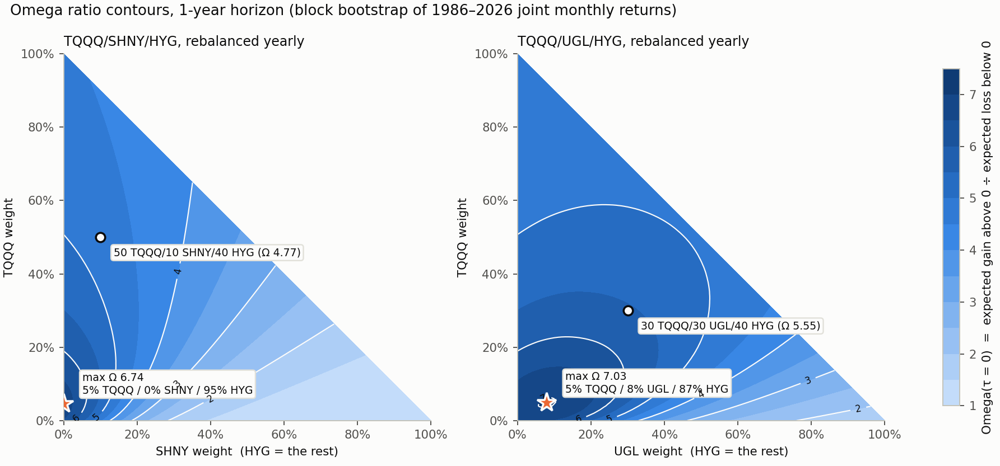
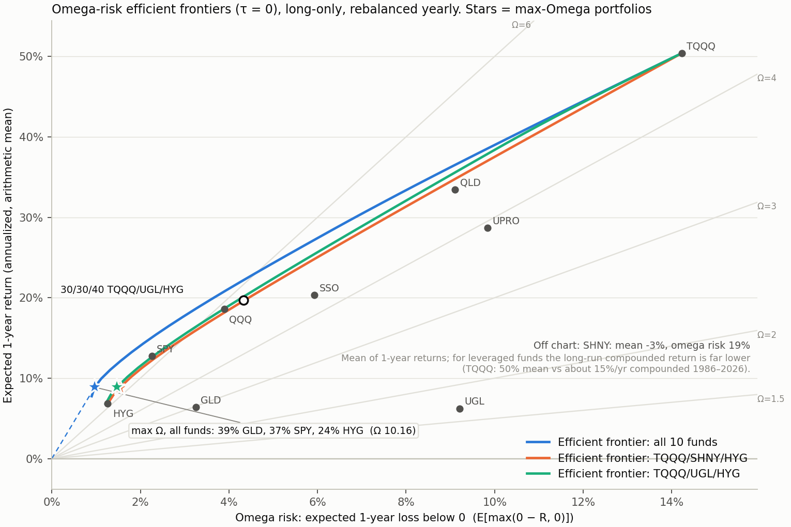

# Omega optimisation, revisited (2026): review of the 2022 notebooks + leveraged-ETF lazy portfolios

## 1. Review of the 2022 code

### `Omega Portfolio.ipynb`: the formulation is right, the solver doesn't optimise
The plan is sound: minimise the Omega denominator (expected shortfall below τ, "omega risk") subject to a minimum
expected return, then sweep that minimum to find the Omega-maximising portfolio.

The problem is the solver. It descends on h = ½‖∇L‖² (the squared gradient of the Lagrangian). The objective
E[max(τ − wᵀr, 0)] is piecewise linear in w, so ∂²L/∂w² = 0 almost everywhere. That makes

    ∂h/∂w_k = r̃_k·∂L/∂θ + sign(w_k)·∂L/∂λ₂ + ∂L/∂λ₁

which is exactly the code's `gradient_var`. **The weight update contains no term from the objective.** The objective
only moves the multipliers λ₁, λ₂, θ, and those never feed back into w. So w is the random start pushed onto the
constraints, and "best Omega over 1,000 random starts" is a random search.

`omega/legacy_check.py` demonstrates this on the notebook's own toy assets:
- **Identical paths:** two runs from the same start with *different* return samples follow identical weight paths
  (max difference 0.0 over 10,000 steps).
- **Ω comparison**, on the same samples:

| Method | Ω |
|---|---|
| Notebook | 1.118 |
| Exact LP | **1.246** |
| Brute force, 200k random portfolios | 1.239 |

Smaller issues:
- `omega()` mixes the exact expectation (numerator) with a 100-draw sampled shortfall (denominator).
- `denom()` ignores its `returns` argument and reads the global `R_sample`.
- `h_hessian` is not the Hessian of h (unused).
- Assets 5 and 6 are the same distribution.
- The README objective is missing the max(·, 0).
- Assets are sampled independently, so no joint dependence. Real assets need joint scenarios (rows).

### `MGF Objective.ipynb`
- **Correct as written:** the gradient of h (L is separable, so the cross second derivatives vanish), and the
  factorisation M_Z(1) = Π M_Xk(a_k), given independence.
- **Sign issue:** minimising M_Z(+1) = E[e^Z] penalises *upside* as much as downside. A downside-risk version is the
  entropic risk (1/t)·log E[e^(−tZ)], i.e. M_Z(−t).

## 2. Exact solver: `omega/omega_lp.py`
- **Max Omega:** maximising Ω is a linear-fractional programme. With the Charnes–Cooper substitution y = t·w it
  becomes an LP, solved exactly with HiGHS:
  `max μᵀy − τt  s.t.  mean(d) = 1,  d_j ≥ τt − R_j y,  d ≥ 0,  1ᵀy = t,  y, t ≥ 0`.
- **Frontier:** the (omega risk, return) efficient frontier is the LP family `min mean(d)  s.t.  d_j ≥ τ − R_j w,
  μᵀw ≥ m,  1ᵀw = 1,  w ≥ 0`.
- **Weights:** long-only and fully invested (the 2022 constraints 1ᵀw = 1 and 1ᵀ|w| = 1 imply exactly this).

## 3. Study: `omega/study.py`, `omega/plots.py` (τ = 0)
- **Joint distribution:** 20,000 one-year scenarios from a stationary block bootstrap (mean block 6 months) of the
  joint monthly returns in `data/monthly_returns.csv` (10 funds, Oct 1986 – Oct 2026; see `data/README.md`).
- **Why one-year scenarios:** holding fixed weights for a year is the same as rebalancing once a year, so wᵀR_j is
  the yearly-rebalanced lazy portfolio's return.

| Portfolio | Ω(0) | Mean 1-yr return | Omega risk | P(1-yr loss) | Historical CAGR 1986–2026 | Worst drop |
|---|---|---|---|---|---|---|
| **Max Ω, all 10 funds:** 39% GLD / 37% SPY / 24% HYG | **10.16** | 8.9% | 1.0% | 16% | 8.6% | −26% |
| Max Ω, TQQQ/UGL/HYG: 5% / 8% / 87% | 7.03 | 8.9% | 1.5% | 20% | 8.6% | −35% |
| Max Ω, TQQQ/SHNY/HYG: 5% / 0% / 95% | 6.74 | 8.8% | 1.5% | 20% | 8.4% | −37% |
| 30 TQQQ / 30 UGL / 40 HYG | 5.55 | 19.7% | 4.3% | 28% | 17.4% | −68% |
| 50 TQQQ / 10 SHNY / 40 HYG | 4.77 | 27.6% | 7.3% | 31% | 20.4% | −88% |
| 100% SPY | 6.65 | 12.7% | 2.3% | 20% | 11.6% | −51% |
| 100% QQQ | 5.77 | 18.6% | 3.9% | 22% | 15.4% | −81% |
| 100% TQQQ | 4.54 | 50.4% | 14.2% | 33% | 15.4% | −100% |

### Reading it
- **Ω(0) favours low risk.** Gains are scaled by losses, so the maximiser lands near the bottom of the frontier, where
  expected losses are smallest. On the frontier chart this is the ray from the origin with the steepest slope.
- **Leverage doesn't raise Ω.** Every leveraged mix has a lower Ω than SPY. Leveraged funds widen the loss tail
  about as fast as they raise the mean.
- **But leveraged mixes sit on the frontier.** 30/30/40 TQQQ/UGL/HYG lies essentially on the efficient frontier,
  next to QQQ, at about 20% mean return and 4.3% omega risk. It is the efficient way to *get* that much return,
  but not the Omega-optimal portfolio.
- **SHNY is never chosen.** Its ~T-bill + 7% financing makes its 1-year mean negative (−3%).
- **Mean overstates compounding.** The y-axis is the arithmetic mean of 1-year returns. For leveraged funds the
  long-run compounded return is far lower (TQQQ: 50% mean vs about 15%/yr compounded).

### Robustness
- **Historical 12-month windows** (480 overlapping, instead of the bootstrap): max Ω = 40% GLD / 25% SPY / 34% HYG
  (Ω 10.9). Same answer.
- **Out of sample** (fit on 1986–2005, test on 2006–2026):

| Portfolio | Ω, fit | Ω, test | 2006–26 CAGR | Worst drop |
|---|---|---|---|---|
| Max Ω, all funds | 15.5 | 7.2 | 7.3% | −28% |
| Max Ω, TQQQ/UGL/HYG (≈100% HYG) | 13.1 | 4.5 | 5.4% | −35% |
| 30/30/40 (fixed) | 4.2 | 8.2 | 20.0% | −49% |

  The in-sample Ω-maximiser loses most of its edge out of sample (classic estimation error in ratio optimisation).

How the joint distribution (marginals + copula) was built: [`COPULA.md`](COPULA.md).

Run: `python omega/study.py && python omega/plots.py` (numpy, pandas, scipy ≥ 1.9, matplotlib).
`results/summary.json` has every number, plus frontier weights.

## Follow-up
[`IMPLIED.md`](IMPLIED.md) adds three things:
- **Option-implied marginals:** PricedIn's formulation solved exactly as a QP, with Q and P measures and the
  historical copula.
- **Compounded-growth frontiers:** realised growth vs the arithmetic mean.
- **Walk-forward test:** a yearly refit on the trailing 10 years, 1997–2026.
