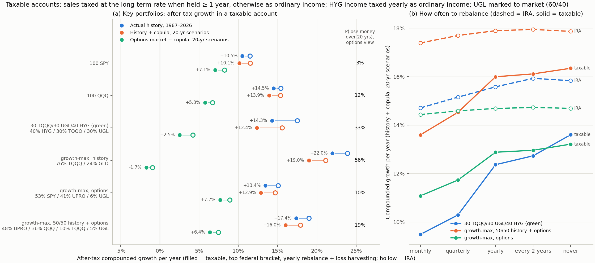

# Taxable accounts: key portfolios, rebalancing, growth-maximising mixes

Code: `omega/taxable.py`, `omega/taxable_plots.py`. Numbers: `results/taxable_summary.json`.

## Three views of the next 20 years (same historical copula in all three)
| View | What it is |
|---|---|
| Actual history | The real monthly path, Jan 1987 – Oct 2026 (funds simulated before inception) |
| History + copula | 10,000 twenty-year paths: block bootstrap of joint months |
| Options + copula | 10,000 twenty-year paths: 16 independent draws of the option-implied 15-month joint scenarios ([`IMPLIED.md`](IMPLIED.md), real-world tilt: equity +5%/yr, HY +2%, gold 0) |

"Growth" is the expected compounded rate, exp(E[log wealth]/years) − 1, after tax.

## Tax model
US federal, top bracket (no state): ordinary 40.8%, long-term gains / qualified dividends 23.8%. A middle bracket
(24% / 15%) is in the JSON.

| Fund | Treatment |
|---|---|
| SPY, QQQ | Dividends qualified (1.3% / 0.6% yield) |
| HYG | ~6.5% payout taxed each year as **ordinary income** |
| TQQQ, UPRO, QLD, SSO | Payouts (0.5–1%) ordinary; no capital-gain distributions assumed |
| GLD | Grantor trust: long-term gains taxed as a collectible (28% + 3.8%) |
| UGL | ProShares Trust II commodity pool (K-1): Section 1256, **marked to market every year** at 60% long-term / 40% short-term |
| SHNY | ETN: capital gain on sale (treatment of gold-linked ETNs is unsettled) |

**How sales and losses are handled**
- **Basis:** average cost per fund. Each tax year's bill is paid out of the portfolio.
- **Rebalancing sales:**
  - long-term if the last rebalance was at least 12 months ago;
  - otherwise ordinary rates.
- **Losses:** net against gains and carry forward.
- **Tax-loss harvesting:** sell a fund once it is 10% below basis, then hold a non-identical substitute for 31 days (TQQQ ↔ UPRO/QLD). It is modeled as a basis reset with unchanged returns.
- **End of the 20 years:** everything is sold and taxed.
  - Holding until death instead (step-up in basis) would remove that final bill.
  - So the after-tax numbers here are conservative.

## Key portfolios (taxable, top bracket, yearly rebalance + loss harvesting; IRA in brackets)
| Portfolio | Actual history | History + copula | Options + copula | Options: P(lose money in 20 yrs) | Worst drawdown, actual history |
|---|---|---|---|---|---|
| 100 SPY | 10.5% (11.5%) | 10.1% (11.5%) | 7.1% (8.2%) | 3% | −52% |
| 100 QQQ | 14.5% (15.4%) | 13.9% (15.4%) | 5.8% (6.7%) | 12% | −81% |
| 30 TQQQ / 30 UGL / 40 HYG ("green") | 14.3% (17.5%) | 12.4% (15.6%) | **2.5%** (4.2%) | **33%** | −64% |
| **Growth-max, options view:** 53 SPY / 41 UPRO / 6 UGL | 13.4% (15.1%) | 12.9% (14.7%) | **7.7%** (8.9%) | 10% | −72% |
| **Growth-max, 50/50 history + options:** 48 UPRO / 36 QQQ / 10 TQQQ / 5 UGL | 17.4% (19.0%) | 16.0% (17.9%) | 6.4% (7.5%) | 19% | −88% |
| Growth-max, history: 76 TQQQ / 24 GLD | 22.0% (23.9%) | 19.0% (21.1%) | **−1.7%** (−0.9%) | **56%** | −96% |

### What this says
1. **Taxes barely change *which* mix maximises growth.** The disagreement between history and the options market does.
   - **Tax-free vs taxable optima:** the optimiser picks nearly the same weights in an IRA as in a taxable account
     (within about 4 points per fund).
   - **History:** maximum growth means 76% TQQQ.
   - **Options market:** the same mix compounds at **−1.7%/yr**, with a 56% chance of losing money over 20 years.
     The options-implied growth-optimal mix is about 1.8× the S&P (53 SPY / 41 UPRO) and holds no TQQQ.
2. **The green mix pays the most tax:** 3.2 points/yr in a taxable account vs about 1 point for SPY/QQQ.
   - **HYG income:** about 0.8–1.0 point of that. The payout is taxed as ordinary income every year. HYG belongs in
     an IRA, if anywhere.
   - **UGL's mark-to-market:** only about 0.1 point. It is mostly a paperwork problem (K-1).
   - **History after tax:** green roughly ties QQQ (14.3% vs 14.5%) and beats SPY.
   - **Options view:** it compounds at 2.5% with a one-in-three chance of losing money over 20 years.
3. **Proposed taxable portfolios:**
   - **Options-view growth-max: 53 SPY / 41 UPRO / 6 UGL.** The most robust choice. It is the best mix under the
     options view and gives up only about 1 point to QQQ under history.
     - The 6% UGL adds only about 0.1 point of growth, but it trims drawdowns: the worst drop on the actual path is
       −72% with it, −79% without.
     - To avoid a K-1, use **55 SPY / 45 UPRO**: 13.6% / 13.1% / 7.6% after tax in the three views.
   - **50/50 blend: 48 UPRO / 36 QQQ / 10 TQQQ / 5 UGL.** For anyone who gives history half the weight. It has more
     upside, but a −88% drawdown in 2000–02.
     - Don't round TQQQ up. At 50 UPRO / 35 QQQ / 15 TQQQ the options-view growth drops from 6.4% to 5.6%, and the
       chance of losing money over 20 years rises from 19% to 24%.
   - **Both are full-growth (Kelly) bets.** A −50 to −90% drawdown is part of the deal. Half the leverage gives up
     a little growth for much shallower drawdowns.

## Rebalancing (syrup's question)
Panel (b) shows the history + copula view. In this view, rebalancing more often never helps: it loses even
tax-free, because these assets trend.

| How often | Green: IRA | Green: taxable | 50/50 mix: IRA | 50/50 mix: taxable |
|---|---|---|---|---|
| Monthly | 14.7% | **9.5%** | 17.4% | 13.6% |
| Quarterly | 15.2% | 10.3% | 17.7% | 14.5% |
| Yearly | 15.6% | 12.4% | 17.9% | 16.0% |
| Every 2 years | 15.9% | 12.7% | 17.9% | 16.1% |
| Never | 15.8% | 13.6% | 17.9% | 16.3% |

- **In a taxable account, rebalance at most once a year, on or after the 1-year mark.** Monthly or quarterly
  rebalancing realises short-term gains at 40.8% and costs 3–5 points/yr. Bands checked monthly (±10 pp) are worse
  than yearly for the same reason.
- **"Never" is not free either.** On the actual 1987–2026 path, the never-rebalanced green mix drifted into mostly
  TQQQ before 2000 and compounded at 9.9%, vs 14.3% with yearly rebalancing. Yearly, plus harvesting losses, is the
  robust rule.
- **Better still: rebalance with new money.** Direct contributions (and the year's dividends) to the underweight
  fund instead of selling. That gets most of the rebalancing benefit with no realised gains. Not modeled here (lump
  sum, no contributions).
- **Harvesting adds about 0.1–0.4 point/yr.** It is larger in practice with lot-level (HIFO) accounting than with
  the average cost modeled here.

## Caveats
- **Federal only.** State tax (e.g. CA 13.3%) would add to every drag above.
- **HYG yield is 6.5% throughout.** Historical high-yield payouts were higher, so history understates its tax drag.
- **The options view is a stationary 15-month distribution repeated for 20 years.** Drawdowns in it are measured at
  15-month steps, so they understate intra-period drawdowns.
- **Tax treatment of UGL (K-1 character) and SHNY (ETN) is simplified.** Check with a tax adviser.

Run: `python omega/taxable.py && python omega/taxable_plots.py` (~8 min).
